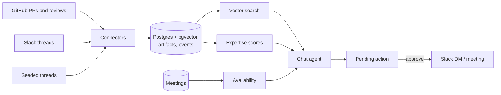

# Pinpoint

Pinpoint turns a team's Slack and GitHub history into a live map of who knows what, so a new hire can find the right person to ask, see whether they have time, and reach out in one click.

New engineers lose days working out who to ask. The person who knows best is often the busiest, and asking the wrong person costs both sides. Pinpoint answers the question first, from the team's own PRs and threads with every claim cited, then routes to someone who knows the area and actually has time this week.

## What it does

Priya joined Integrations three days ago. She asks *"How does inbound email sync work?"*

1. **Answers from the team's history.** Pinpoint searches merged PRs and Slack threads and writes a short answer. Every sentence links to the PR or thread it came from.
2. **Finds who knows it, with receipts.** Dana wrote most of this code (128 Messaging PRs). Marcus reviewed 38 of those PRs. Every ranking shows its evidence.
3. **Checks bandwidth.** Dana is 78% booked this week, Marcus 35%. Pinpoint recommends Marcus, on Priya's own team, and marks Dana as busy.
4. **Drafts the DM.** Priya edits it if she wants, then approves. It arrives in Marcus's Slack from the Pinpoint bot, on Priya's behalf.
5. **Books the meeting.** "Book time with Marcus Wednesday at 10:30" finds a slot they're both free and books it after she approves.

Nothing is sent or booked without an explicit approval.

It also works inside Slack. Ask a question in `#help` and Pinpoint replies in the thread with a cited answer and who knows the topic. React ✅ on that reply, and the thread is saved as a known answer for the next person who asks. A graph view shows people and topics, and flags topics where only one person really knows the code (bus factor).

The full walkthrough is in [docs/demo.md](docs/demo.md).

## How it works



**One event schema for every source.** Each connector (GitHub, Slack, seeded data) turns raw data into the same normalized events: who authored, reviewed, asked or answered what, and when. Nothing downstream knows where an event came from, so adding a source means writing one adapter.

**Expertise is a dumb, explainable formula**, not a model. Each piece of evidence counts by type and fades with age:

```
score(person, topic) = Σ weight(event type) × 0.5 ^ (age in days / 90)
```

| Evidence | Weight |
| --- | --- |
| Authored a merged PR | 1.0 |
| Answered a question in Slack | 0.8 |
| Reviewed a PR | 0.7 |
| Asked a question | 0.1 |

Topics come from file paths (`modules/messaging` is Messaging) for code, and from a batched LLM tag for Slack threads. For a free-form question, Pinpoint embeds it, finds the closest PRs and threads, and credits the people on them. The final ranking is **expertise × availability**, where availability comes from this week's meeting load and open review count.

**The LLM writes prose; code enforces the rules.** The model is free and open source, so Pinpoint doesn't trust it with anything that matters:

- It may only name people the expert search returned. A sentence naming anyone else is cut.
- Citations are checked. A marker that doesn't match a source is dropped, a PR number the answer mentions gets that PR's citation, and sentences with no citation are removed.
- Who to recommend, the free time slots, and the booking are all computed in code.
- Sends and bookings only create a pending action. Only an approval executes it, and a double click runs it once.
- If the model is slow (over 30s) or fails, a code-written answer that lists the sources takes over.

## Data

There's no real company data. Pinpoint runs on a fictional company, "Acme", built from real open-source history:

- **GitHub:** 3,944 merged PRs from the last six months of [twentyhq/twenty](https://github.com/twentyhq/twenty), an open-source CRM, with their authors, reviewers and changed files. The 16 most active contributors are mapped to fictional Acme engineers in [`people.json`](people.json). Real names are never shown.
- **Slack:** about 300 Q&A threads generated by an LLM. Code picks who asks and who answers from the GitHub data, so Slack and GitHub agree on who the experts are. The LLM writes only the words, based on real PRs, and any sentence naming a PR or code identifier it wasn't given is dropped. Five threads the demo relies on are hand-written.
- **Live Slack:** the team's real workspace, public channels the bot is invited to only. Two real teammates play Priya and Marcus, so the approved DM really arrives.
- **Calendars:** a generated week of meetings (standups, 1:1s, project meetings), with a few seniors deliberately over 70% booked. There are no real calendars; everything goes through one `get_availability()` function, so a real calendar API could replace it.

## Stack

| Layer | Choice |
| --- | --- |
| Backend | Python 3.13, FastAPI, managed with `uv` |
| Database | Postgres + pgvector on Supabase |
| Embeddings | `BAAI/bge-small-en-v1.5` via fastembed: local, free, works offline |
| LLM | A free model on OpenRouter (Nemotron 3 Super), through the OpenAI SDK |
| Frontend | Next.js 16, Tailwind |
| Slack | `slack_sdk`, polling every 30s (no public URL needed) |
| GitHub | GraphQL API |

## Run it

The frontend runs on its own against example data in [`fixtures/`](fixtures/), with no backend:

```
cd frontend
npm install
npm run dev        # http://localhost:3000, uses fixtures by default
```

For the real thing you need Python 3.13 with [uv](https://docs.astral.sh/uv/), a Supabase project with pgvector, an [OpenRouter](https://openrouter.ai) key and a GitHub token. Slack is optional.

1. Copy `.env.example` to `.env` and fill in `DATABASE_URL` (the Supabase **session pooler** string), `OPENROUTER_API_KEY` and `GITHUB_TOKEN`. Leave `PINPOINT_MODE=seeded` so nothing is sent to Slack.
2. Build the data, from `backend/`. The first run is slow: GitHub ingest takes about 10 minutes, embedding about 15, and seeding about an hour on a free model. Every step caches, so reruns are fast.
   ```
   uv sync
   uv run python -m scripts.init_db        # tables
   uv run python -m scripts.load_people    # the Acme org and topics
   uv run python -m scripts.ingest_github  # 6 months of twentyhq/twenty
   uv run python -m scripts.seed           # seeded Slack threads
   uv run python -m scripts.embed          # vectors for search
   uv run python -m scripts.score          # expertise table
   uv run python -m scripts.gen_meetings   # this week's calendars
   uv run python -m scripts.warm_demo      # cache the demo answers
   ```
3. Start the API: `uv run uvicorn api.main:app` (port 8000).
4. Point the frontend at it: in `frontend/.env.local`, set `NEXT_PUBLIC_USE_FIXTURES=0`, then `npm run dev`.

To connect Slack, follow [docs/slack-setup.md](docs/slack-setup.md) (about 15 minutes), then `uv run python -m scripts.ingest_slack` and, for the `#help` bot, `uv run python -m scripts.help_bot`. Real DMs and `#help` replies go out only with `PINPOINT_MODE=live`. Between rehearsals, `uv run python -m scripts.reset_demo` clears test DMs, bookings and bot replies.

## Tests

```
cd backend
uv run pytest            # unit tests, no network or database
uv run pytest -m demo    # golden tests against the real database: the demo questions,
                         # the sources they should find, and who should be recommended
cd ../frontend
npm run typecheck
```

The golden tests guard the demo story. If a change to scoring, search or seeding means "How does inbound email sync work?" no longer recommends Marcus over a busy Dana, they fail.

## Repo layout

```
backend/
  connectors/   GitHub and Slack adapters; each emits the same normalized events
  seed/         seeded Slack threads, calendars, demo questions
  graph/        scoring, find_experts, availability, bus factor
  agent/        chat agent, approvals, #help bot
  api/          FastAPI routes
  scripts/      one entry point per pipeline step
frontend/       Next.js app and mockups
fixtures/       example JSON for every API response (the frontend's contract)
people.json     the fictional Acme org and its identity map
docs/           demo script, Slack setup, team split
```

## Privacy

Pinpoint reads only public Slack channels the bot has been invited to. A per-person opt-out isn't built yet. Topic tagging and answers send text to a free model on OpenRouter, so sensitive channels shouldn't be connected.

## Team

Built at a hackathon by Jasmehar Kaur and Harshita Chandani.
