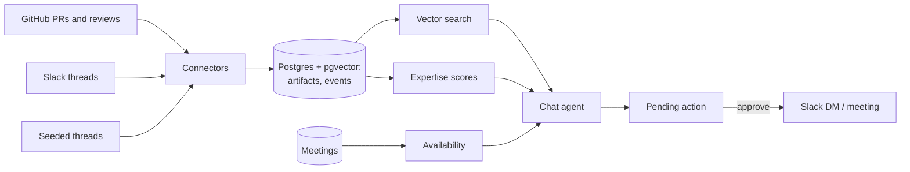

# Pinpoint

**An onboarding agent that answers a new hire's question from the team's own history, finds the person who knows it and has time, and drafts the message and the meeting, with the new hire approving every step.**

## The problem

The first months at a company are spent figuring out who knows what. The knowledge exists, scattered across PRs and Slack threads, and the network that would point you to it is invisible when you're new. So new hires either ping the most senior person they've heard of (who is usually swamped), or stay stuck. Ramp-up slows, and the same few experts drown in interruptions.

## Who it's for

- **New hires and early-career engineers**, the primary user. Our persona is Priya Shah, three days into the Integrations team.
- **The experts they need.** Pinpoint routes around people who are already overloaded, protecting their time.
- **Managers.** The same data shows where knowledge sits with a single person (bus factor).

## What it does

Priya asks *"How does inbound email sync work?"*

1. **Answers first, with sources.** Pinpoint searches the team's merged PRs and Slack threads and writes a short answer. Every sentence links to the PR or thread it came from; a sentence it can't cite is removed.
2. **Finds who knows it, with receipts.** Dana wrote most of this code (128 Messaging PRs). Marcus reviewed 38 of those PRs. Every card shows the evidence behind it.
3. **Checks who has time.** Dana is 78% booked this week, Marcus 35%. Pinpoint recommends Marcus (who is also on Priya's team) and marks Dana as busy.
4. **Drafts the DM.** It opens "I'm Priya, new on Integrations" and attaches its sources. Priya edits it or asks for a shorter version, then approves. It arrives in Marcus's Slack from the Pinpoint bot, on her behalf.
5. **Books the meeting.** "Book time with Marcus Wednesday at 10:30" shows both calendars and the times they're both free; Priya picks one and approves.

It also works where people already ask:

- **Slack `#help`:** Pinpoint answers new questions in the thread on its own, with sources, who knows the topic and how booked they are. React ✅ and the thread is saved as a known answer, so the next new hire gets it instantly.
- **In the code:** a floating bubble on a code page shows who knows the file you're reading, and answers questions about it.
- **For managers:** a graph of people and topics, with a bus factor view that flags topics only one person knows.

The live walkthrough is in [docs/demo.md](docs/demo.md).

## What the agent does on its own, and where the human decides

| Pinpoint does on its own | The human decides |
| --- | --- |
| Searches PRs and threads and writes a cited answer | Whether the answer is enough, or to ask someone |
| Ranks who knows the topic, from evidence | Whether that's the right person (**Not the right person?** corrects it) |
| Checks calendars and open reviews to see who has time | Who to contact |
| Drafts the DM and attaches context | Edits, rewrites shorter, sends, or cancels |
| Finds times both people are free | Which slot, and whether to book |
| Answers new questions in `#help`, in the thread | Whether the answer helped (✅ saves it for others) |

Sending a message and booking a meeting are the only actions with side effects, and **neither happens without an explicit approval**. The agent only creates a pending action; an approval executes it, once.

## Designed for trust

How a user can tell, for each item in Workday's "Design for Trust" checklist:

| The user knows… | How Pinpoint shows it |
| --- | --- |
| What the AI is doing | A status line while it searches; answers, recommendations and drafts are clearly separate cards |
| Why it made a recommendation | Each expert card shows the evidence line ("Reviewed 38 of Dana's Messaging PRs"), availability ("35% booked · 2 open reviews") and the top PRs and threads behind it |
| What data it used | Numbered citation chips on every claim, linking to the PR or thread; context chips on the DM |
| What action it wants to take | "Slack DM to Marcus Lee · Needs approval" and "Meeting with Marcus Lee", with the full text, time and attendees |
| Where to approve, edit or reject | Approve and send, Rewrite shorter, an editable draft, Cancel; pick a different slot or dismiss the meeting |
| What the system will not do | See the list below |
| When a human needs to be involved | Every send and every booking |
| What happens when it's uncertain | It says "I couldn't find anything about that in the team's PRs and threads" instead of guessing; if everyone who knows the topic is busy, it says so; if the model is slow or fails, a plain list of the best sources appears instead |
| How to correct or challenge it | **Not the right person?** on any expert card lowers that person's ranking on that topic for everyone; every claim can be checked against its source |

**What Pinpoint will not do**

- Send a message or book a meeting without approval.
- Name anyone who isn't backed by evidence. The model may only mention people the expert search returned; any other name is cut.
- State something it can't cite. Uncited sentences, invented PR numbers and citations that don't match a source are removed in code.
- Read private channels or DMs. It only reads public channels the bot was invited to.
- Rate people. Expertise scores exist to route questions. They aren't performance signals, and Pinpoint makes no decisions about anyone's job, pay or performance.

## Responsible AI

**Transparent.** Every answer cites its sources, and every recommendation shows its numbers. The ranking is a formula you can read (below), not a model.

**Fair.** Expertise is inferred from visible activity, which has a known bias: people who write lots of PRs and answer in public channels look like experts, while people who help in DMs, in meetings, or who are new are under-counted. What Pinpoint does about it:
- Reviews and Slack answers count, not just authored code, so reviewers like Marcus surface.
- Evidence fades with age (half-life 90 days), so tenure alone doesn't dominate.
- Availability spreads questions away from the same few busy seniors, which protects their time and gives near-experts the questions that grow them.
- Anyone can correct a recommendation.
- Same-team preference is a small 10% nudge that only breaks close calls, so other teams' experts aren't shut out.
- The bus factor view flags *topics*, not people.

**Accountable.** The human approves every action with an effect on someone else, and can edit or cancel it first.

**Privacy-preserving.** The demo uses no real employee data. The company is fictional, and the expertise comes from a public open-source repo, mapped to fictional people. In live mode Pinpoint reads only public channels the bot is invited to. Embeddings run locally. Answers and topic tagging send text to a hosted model, so a real deployment should use one the company has approved, and keep sensitive channels unconnected. A per-person opt-out isn't built yet.

**Reliable.** Who to recommend, free times and bookings are computed in code, not by the model. Approvals can't double-send. Slow model calls time out after 30 seconds and fall back to a plain answer. 29 golden tests run against the real database and fail if the demo's answers, sources or recommendations drift.

## Data and assumptions

There is no real company data. Pinpoint runs on a fictional company, "Acme", built from public data:

- **GitHub:** 3,944 merged PRs from the last six months of [twentyhq/twenty](https://github.com/twentyhq/twenty), an open-source CRM, with authors, reviewers and changed files. The 16 most active contributors are mapped to fictional Acme engineers in [`people.json`](people.json). Real names are never shown.
- **Slack:** about 300 Q&A threads generated by an LLM. Code decides who asks and who answers from the GitHub data, so Slack and GitHub agree on who the experts are. The LLM writes only the words, from real PRs, and any sentence naming a PR or code identifier it wasn't given is dropped. Five threads the demo relies on are hand-written.
- **Live Slack:** our own workspace, public channels only. The two of us play Priya and Marcus, so the approved DM really arrives.
- **Calendars:** a generated week of meetings (standups, 1:1s, project meetings), with a few seniors deliberately over 70% booked. Everything goes through one `get_availability()` function, so a real calendar API can replace it.
- **Assumptions:** an expert is someone with recent evidence on a topic; topics come from code paths; availability means this week's meeting load plus open reviews.

## How a real organization would use it

- **Faster ramp-up.** A new hire goes from question to an answer, the right person and a booked meeting in about a minute, instead of days of asking around.
- **Protected expert time.** Questions spread to people who know the area and have room, instead of always landing on the same senior.
- **Knowledge that compounds.** Every ✅ in `#help` becomes an answer the next person gets instantly.
- **Workforce decisions.** Bus factor shows managers where knowledge sits with one person, and who is next closest. That's a starting point for pairing, mentoring and succession planning, so a near-expert can grow into a second owner.
- **Fits the tools a company already has.** Each source is one adapter that emits the same events. Slack and GitHub work today. In a company, the org chart, teams and managers (now in `people.json`) would come from the HR system, such as Workday, and calendars from the company calendar.

## Limitations

- One demo user (Priya). There's no sign-in.
- Corrections apply to everyone immediately, with no review.
- Chat conversations live in the server's memory, so a restart forgets open chats (drafts and bookings persist).
- No per-person opt-out yet.

## How it works



**One event schema for every source.** Each connector (GitHub, Slack, seeded data) turns raw data into the same normalized events: who authored, reviewed, asked or answered what, and when. Nothing downstream knows where an event came from, so adding a source means writing one adapter.

**Expertise is a simple, explainable formula**, not a trained model. Each piece of evidence counts by type and fades with age:

```
score(person, topic) = Σ weight(event type) × 0.5 ^ (age in days / 90)
```

| Evidence | Weight |
| --- | --- |
| Authored a merged PR | 1.0 |
| Answered a question in Slack | 0.8 |
| Reviewed a PR | 0.7 |
| Asked a question | 0.1 |

Topics come from file paths (`modules/messaging` is Messaging) for code, and from a batched LLM tag for Slack threads. For a question, Pinpoint embeds it, finds the closest PRs and threads, and credits the people on them; a PR named in the question ("what's PR 28080?") counts most. The final ranking is **expertise × availability**, where availability comes from this week's meeting load and open review count.

**The LLM writes prose; code enforces the rules.** The model is free and open source, so Pinpoint doesn't trust it with anything that matters. Names, citations, recommendations, free times and actions are all checked or computed in code, as described under "Designed for trust".

## Stack

| Layer | Choice |
| --- | --- |
| Backend | Python 3.13, FastAPI, managed with `uv` |
| Database | Postgres + pgvector on Supabase |
| Embeddings | `BAAI/bge-small-en-v1.5` via fastembed: local, free, works offline |
| LLM | A free model on OpenRouter (Nemotron 3 Super), through the OpenAI SDK |
| Frontend | Next.js 16, Tailwind |
| Slack | `slack_sdk`, polling (no public URL needed) |
| GitHub | GraphQL API |

## Run it

The frontend runs on its own against example data in [`fixtures/`](fixtures/), with no backend:

```
cd frontend
npm install
npm run dev        # http://localhost:3000, uses fixtures by default
```

For the real thing you need Python 3.13 with [uv](https://docs.astral.sh/uv/), a Supabase project with pgvector, an [OpenRouter](https://openrouter.ai) key and a GitHub token. Slack is optional.

1. Copy `.env.example` to `.env` and fill in `DATABASE_URL` (the Supabase **session pooler** string), `OPENROUTER_API_KEY` and `GITHUB_TOKEN`. Leave `PINPOINT_MODE=seeded` so nothing is sent to Slack.
2. Build the data, from `backend/`. The first run is slow: GitHub ingest takes about 10 minutes, embedding about 15, and seeding about an hour on a free model. Every step caches, so reruns are fast.
   ```
   uv sync
   uv run python -m scripts.init_db        # tables
   uv run python -m scripts.load_people    # the Acme org and topics
   uv run python -m scripts.ingest_github  # 6 months of twentyhq/twenty
   uv run python -m scripts.seed           # seeded Slack threads
   uv run python -m scripts.embed          # vectors for search
   uv run python -m scripts.score          # expertise table
   uv run python -m scripts.gen_meetings   # this week's calendars
   uv run python -m scripts.warm_demo      # cache the demo answers
   ```
3. Start the API: `uv run uvicorn api.main:app` (port 8000).
4. Point the frontend at it: in `frontend/.env.local`, set `NEXT_PUBLIC_USE_FIXTURES=0`, then `npm run dev`.

To connect Slack, follow [docs/slack-setup.md](docs/slack-setup.md) (about 15 minutes), then `uv run python -m scripts.ingest_slack` and, for the `#help` bot, `uv run python -m scripts.help_bot`. Real DMs and `#help` replies go out only with `PINPOINT_MODE=live`. Between rehearsals, `uv run python -m scripts.reset_demo` clears test DMs, bookings, bot replies and corrections.

## Tests

```
cd backend
uv run pytest            # unit tests, no network or database
uv run pytest -m demo    # golden tests against the real database: the demo questions,
                         # the sources they should find, and who should be recommended
cd ../frontend
npm run typecheck
```

## Repo layout

```
backend/
  connectors/   GitHub and Slack adapters; each emits the same normalized events
  seed/         seeded Slack threads, calendars, demo questions
  graph/        scoring, find_experts, availability, bus factor
  agent/        chat agent, approvals, #help bot
  api/          FastAPI routes
  scripts/      one entry point per pipeline step
frontend/       Next.js app and mockups
fixtures/       example JSON for every API response (the frontend's contract)
people.json     the fictional Acme org and its identity map
docs/           demo script, Slack setup, team split
```

## Team

Built at LA Hacks by Jasmehar Kaur and Harshita Chandani, for the Workday "Build the Future of Work with AI" challenge.
